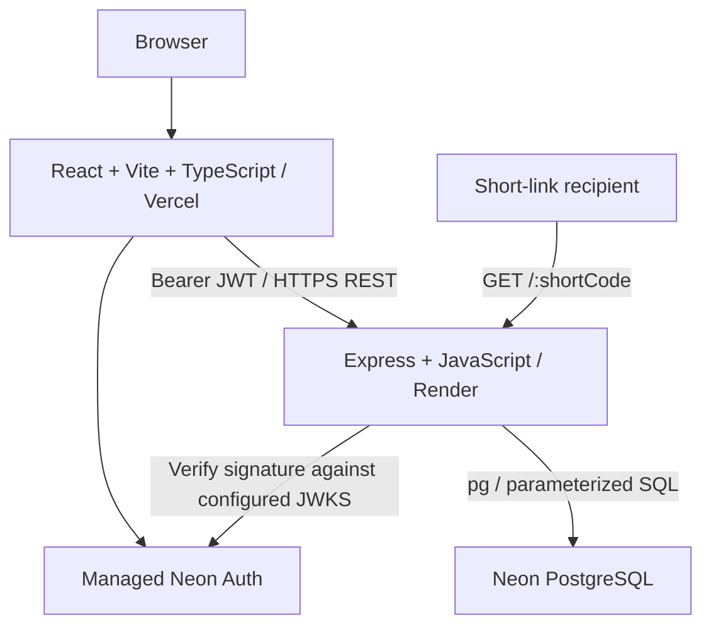

# Shortly architecture

## Overview


Keep the requested stack: React, Vite, TypeScript, Tailwind CSS, Framer Motion, Express, JavaScript, pg, Neon, Render, Vercel, Postman. Managed Neon Auth supplies identity; it does not replace Express or pg. No ORM, browser Data API, Neon Functions, custom password storage, queue, or cache is needed for the MVP.

## Responsibility and layout
The application root is `D:/varma/FULL_DEV_ZERO/Project`, as explicitly requested by the user. All paths below are relative to that directory. The parent README remains historical background; current setup instructions live in Project/README.md.

```text
backend/
  db/schema.sql                 # schema/migrations, Phase 1
  src/
    config/env.js
    app.js                     # composition, injectable dependencies for tests
    server.js                  # listen, startup checks, graceful shutdown
    routes/                    # paths and middleware
    controllers/               # HTTP mapping
    services/                  # workflows and policy
    db/pool.js                 # single pg pool
    db/queries/                # parameterized SQL
    middleware/                # auth, limits, errors, not-found
    utils/                     # URL validation, code generation
  tests/
  postman/
frontend/
  src/
    app/ pages/ components/ hooks/ types/ utils/ styles/
    services/api.ts            # typed API and auth-token attachment
    services/auth.ts           # managed SDK integration
    main.tsx
  public/
```

Directories are reserved in Phase 0; code and package manifests arrive in later phases. The master plan gives conflicting database paths: runtime code will use `backend/src/db`, SQL will use `backend/db`.

## Identity and authorization
Managed Auth owns accounts and sessions. The frontend uses the official SDK for session management and obtains a short-lived token for the separate Express origin. Express verifies signature, EdDSA algorithm, expiry, issuer, audience, and nonempty subject using a trusted configured JWKS URL; it never trusts a decoded-only token or client-supplied owner ID. Reject anonymous identities for private APIs.

`urls.owner_id` stores the verified subject. Every creation, listing, summary, and analytics query uses that identity; clicks inherit ownership through their parent URL. Return indistinguishable 404 responses for missing and foreign-owned resources. API authentication runs independently of frontend route guards. No global list endpoint.

Issuer is the origin of NEON_AUTH_BASE_URL, not its full path; JWKS uses the full base URL plus /.well-known/jwks.json. Confirm actual issued audience during setup. One trusted issuer per environment makes subject a stable owner key. Keep browser sessions under the official SDK, obtain API tokens as needed and do not persist app-managed bearer tokens in localStorage. Check current SDK exports before choosing package pins.

App authorization is enforced in Express SQL queries. RLS is not claimed as an implemented second boundary. A privileged database connection makes missing owner filters a serious risk, covered by two-user integration tests.

Browser-to-Auth cookies cross unrelated domains: verify the installed SDK's supported same-origin proxy or shared-domain setup before implementation acceptance. Do not assume default Vercel/Render/Auth domains work in Safari. Phase 1 must validate provider availability and session integration, and record the chosen setup before auth code is finalized.

## Database and reliability
See [database schema](docs/DATABASE_SCHEMA.md). Use one pool per process, secure Neon connection settings without disabling certificate verification, query/connection timeouts, safe health probes, and graceful pool shutdown. Lookup and click write are separate so a failed click insert can still lead to a valid redirect. Await and handle the bounded insert; no unobserved background promise.

UTC timestamps and SQL aggregations provide analytics. Counts and BIGINT identifiers serialize as decimal strings to avoid JavaScript precision loss. The frontend may safely convert bounded chart values with a range check.

## Configuration and deployment
Backend: `PORT`, `NODE_ENV`, `DATABASE_URL`, `FRONTEND_URL`, `PUBLIC_BASE_URL`, `NEON_AUTH_BASE_URL`, `NEON_AUTH_JWKS_URL`, `NEON_AUTH_ISSUER`, `NEON_AUTH_AUDIENCE`. Frontend: `VITE_API_BASE_URL`, `VITE_NEON_AUTH_URL` (public configuration only). Test infrastructure uses an explicitly separate `TEST_DATABASE_URL`. No secrets belong in `VITE_*` values.

Vercel serves the SPA and route fallback; Render serves API and redirects; Neon stores application data and managed identity. Origin, proxy trust, token claims, and public short-link base URL must be verified against actual deployment configuration. No resources have been provisioned.

## Implemented identity integration
Current SDK: @neon/neon-js 0.10.2. Browser calls /neon-auth on its own origin; Vite proxies this locally and frontend/api/auth.js prepares the corresponding Node gateway for Vercel. Configure server-side NEON_AUTH_BASE_URL on Vercel. Sessions remain managed by the SDK; services/auth.ts obtains API JWTs through the documented token endpoint because the SDK token method returned cached session data during actual QA. App data and redirects remain on Express/Render. Local Chrome and gateway checks pass; production routing and restricted-browser acceptance remain unverified until deployment.

## Future scale considerations
Measure query plans before changing indexes. Large histories may need cursor pagination, rollups, retention, and background event ingestion; distributed rate limits become necessary across backend instances. These are future changes, not current abstractions.
