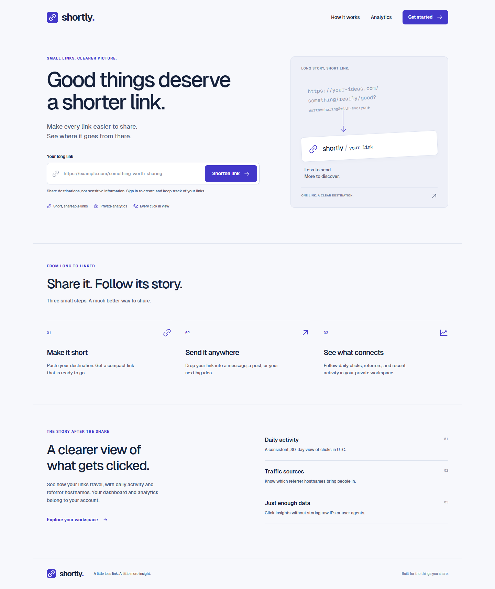

# Shortly

Shortly is an open-source URL shortener with private link management and click analytics.

[Open the live app](https://shortly-vault-cf00.vercel.app) · [API health](https://shortly-api-stbw.onrender.com/api/health)



## What it does

- Create short links from HTTP and HTTPS destinations.
- Keep links and analytics private to the signed-in owner.
- Share public short links that redirect with HTTP 302.
- Track clicks by day, referrer, and recent activity.
- Delete links and their click history from the dashboard.
- Use password confirmation, password requirements, and show/hide password controls when registering.

## Stack

- React, Vite, TypeScript, Tailwind CSS, and Framer Motion
- Node.js, Express, and PostgreSQL through `pg`
- Neon PostgreSQL and Managed Auth
- Vercel frontend and Render API

## Run locally

Use Node.js 22 or later.

```powershell
cd backend
npm ci
Copy-Item .env.example .env
npm test
npm start
```

In another terminal:

```powershell
cd frontend
npm ci --legacy-peer-deps
Copy-Item .env.example .env
npm run dev
```

Set the local database and Auth values in `backend/.env`, and set `VITE_API_BASE_URL` and `VITE_NEON_AUTH_URL` in `frontend/.env`. Never commit `.env` files or credentials.

## Project layout

```text
backend/    Express API, SQL schema, migrations, and tests
frontend/   React application
qa/         Browser and Auth gateway checks
render.yaml Render service configuration
```

## Verification

- 11 backend tests pass.
- The production Chrome journey passed registration, link creation, redirect, private analytics, deletion, sign-out, and sign-in.
- Frontend TypeScript/Vite production build passes.

## License

This project is released under the [MIT License](LICENSE).
